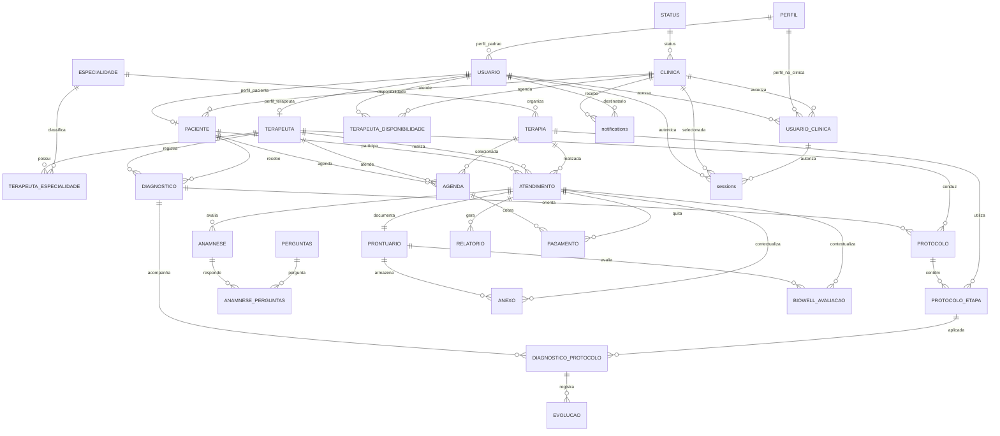

# Diagrama do modelo de dados atual

O diagrama acompanha as chaves configuradas na planilha. A definição física está em `apps/api/src/db/workbook-schema.sql`.

O modelo contém as tabelas de negócio da planilha e mantém apenas `sessions` e `notifications` como tabelas técnicas adicionais. O catálogo `STATUS` é compartilhado entre as entidades que possuem campo de status.
