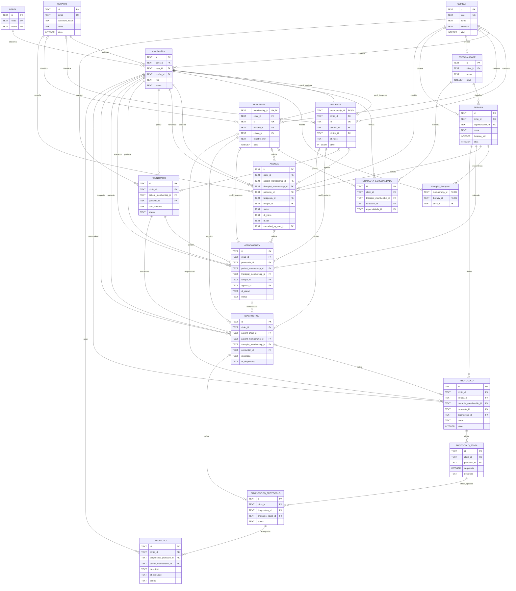
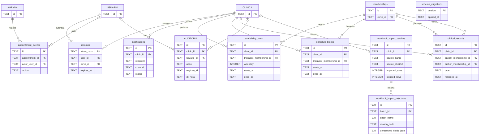

# Modelo Entidade-Relacionamento — QIConect

Modelo do banco SQLite após as migrações `0001` a `0005`. Os diagramas destacam chaves primárias (PK), estrangeiras (FK), únicas (UK) e os principais atributos; campos de auditoria e controle de baixa relevância foram omitidos para facilitar a leitura.

As relações abaixo refletem as chaves estrangeiras declaradas no banco. Quando aplicável, as FKs são compostas por `clinic_id` e pelo identificador do registro para manter o isolamento entre clínicas.

## Clínica, cadastros e atendimento

## Registros clínicos, avaliações e financeiro

```mermaid
erDiagram
    memberships {
        TEXT id PK
        TEXT clinic_id FK
        TEXT role
    }
    ESPECIALIDADE {
        TEXT id PK
        TEXT clinic_id FK
    }
    PERGUNTAS {
        TEXT id PK
        TEXT clinic_id FK
        TEXT specialty_id FK
        TEXT descricao
    }
    ANAMNESE {
        TEXT id PK
        TEXT clinic_id FK
        TEXT atendimento_id FK
        TEXT created_by_membership_id FK
        TEXT tipo
        TEXT dt_registro
    }
    ANAMNESE_PERGUNTAS {
        TEXT id PK
        TEXT clinic_id FK
        TEXT anamnese_id FK
        TEXT pergunta_id FK
        TEXT Resposta
    }
    anamnesis_question_options {
        TEXT id PK
        TEXT clinic_id FK
        TEXT question_id FK
        INTEGER display_order
    }
    anamnesis_assignments {
        TEXT id PK
        TEXT clinic_id FK
        TEXT anamnesis_id FK
        TEXT question_id FK
        INTEGER display_order
    }
    PRONTUARIO {
        TEXT id PK
        TEXT clinic_id FK
        TEXT patient_membership_id FK
    }
    ATENDIMENTO {
        TEXT id PK
        TEXT clinic_id
    }
    ANEXO {
        TEXT id PK
        TEXT clinic_id FK
        TEXT prontuario_id FK
        TEXT atendimento_id FK
        TEXT uploaded_by_membership_id FK
        TEXT storage_key UK
    }
    BIOWELL_AVALIACAO {
        TEXT id PK
        TEXT clinic_id FK
        TEXT patient_chart_id FK
        TEXT patient_membership_id FK
        TEXT atendimento_id FK
        TEXT assessed_by_membership_id FK
        REAL indice_energetico
        REAL indice_estresse
    }
    BIOWELL_CHAKRA {
        TEXT id PK
        TEXT clinic_id FK
        TEXT avaliacao_id FK
        TEXT chakra
        REAL valor
    }
    ANALISE_LINGUA {
        TEXT id PK
        TEXT clinic_id FK
        TEXT patient_chart_id FK
        TEXT patient_membership_id FK
        TEXT atendimento_id FK
        TEXT analyzed_by_membership_id FK
        TEXT imagem
    }
    RELATORIO {
        TEXT id PK
        TEXT clinic_id FK
        TEXT patient_chart_id FK
        TEXT patient_membership_id FK
        TEXT atendimento_id FK
        TEXT generated_by_membership_id FK
        TEXT arquivo_pdf UK
    }
    PACIENTE {
        TEXT membership_id PK, FK
        TEXT id UK
    }
    AGENDA {
        TEXT id PK
        TEXT clinic_id FK
    }
    PACOTE {
        TEXT id PK
        TEXT clinic_id FK
        TEXT patient_membership_id FK
        TEXT paciente_id FK
        TEXT status
    }
    PAGAMENTO {
        TEXT id PK
        TEXT clinic_id FK
        TEXT patient_membership_id FK
        TEXT paciente_id FK
        TEXT agenda_id FK
        TEXT package_id FK
        REAL valor
        TEXT status
    }

    ESPECIALIDADE o|--o{ PERGUNTAS : especializa
    ATENDIMENTO ||--o{ ANAMNESE : registra
    memberships ||--o{ ANAMNESE : autor
    ANAMNESE ||--o{ ANAMNESE_PERGUNTAS : responde
    PERGUNTAS ||--o{ ANAMNESE_PERGUNTAS : pergunta
    PERGUNTAS ||--o{ anamnesis_question_options : oferece
    ANAMNESE ||--o{ anamnesis_assignments : atribui
    PERGUNTAS ||--o{ anamnesis_assignments : seleciona
    PRONTUARIO ||--o{ ANEXO : arquiva
    ATENDIMENTO o|--o{ ANEXO : associa
    memberships ||--o{ ANEXO : envia
    PRONTUARIO ||--o{ BIOWELL_AVALIACAO : contém
    memberships ||--o{ BIOWELL_AVALIACAO : paciente
    memberships ||--o{ BIOWELL_AVALIACAO : avaliador
    ATENDIMENTO o|--o{ BIOWELL_AVALIACAO : contextualiza
    PACIENTE o|--o{ BIOWELL_AVALIACAO : avaliado
    BIOWELL_AVALIACAO ||--o{ BIOWELL_CHAKRA : mede
    PRONTUARIO ||--o{ ANALISE_LINGUA : contém
    memberships ||--o{ ANALISE_LINGUA : paciente
    memberships o|--o{ ANALISE_LINGUA : analista
    ATENDIMENTO o|--o{ ANALISE_LINGUA : contextualiza
    PACIENTE o|--o{ ANALISE_LINGUA : analisado
    PRONTUARIO ||--o{ RELATORIO : contém
    memberships ||--o{ RELATORIO : paciente
    memberships ||--o{ RELATORIO : emissor
    ATENDIMENTO o|--o{ RELATORIO : contextualiza
    PACIENTE o|--o{ RELATORIO : pertence
    memberships ||--o{ PACOTE : adquire
    PACIENTE o|--o{ PACOTE : possui
    memberships ||--o{ PAGAMENTO : paciente
    PACIENTE o|--o{ PAGAMENTO : responsável
    AGENDA o|--o{ PAGAMENTO : quita
    PACOTE o|--o{ PAGAMENTO : utiliza
```

## Suporte operacional e auditoria

## Observações

- `memberships` é o vínculo entre usuário, clínica e perfil; `PACIENTE` e `TERAPEUTA` complementam esse vínculo com dados específicos de cada papel.
- Algumas tabelas mantêm identificadores de planilha (`paciente_id`, `terapeuta_id`, entre outros) além dos vínculos por `memberships`. O diagrama registra somente relações que têm FK declarada no esquema.
- `ANEXO`, `ANALISE_LINGUA` e `RELATORIO` armazenam referências/metadados de arquivos; o conteúdo não é armazenado como coluna binária no SQLite.
- `sessions.token_hash` representa o hash do token de sessão, não o token em texto claro.
- Tabelas auxiliares de importação e auditoria podem conter dados sensíveis. Restrinja o acesso ao banco SQLite e aos arquivos de backup.
